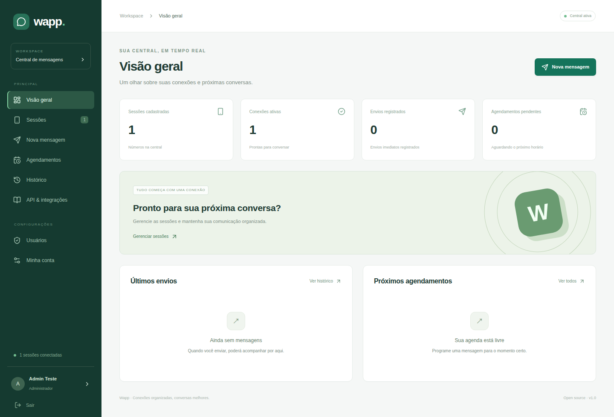

<p align="center"><strong>WAPP</strong> · Central de mensagens</p>

# Uma central para suas conexões WhatsApp

Monorepo open source para gerenciar sessões WhatsApp, enviar texto, consultar
contatos e grupos e agendar mensagens. Inclui painel React, API Express com JWT,
PostgreSQL, histórico de envios e execução com Docker Compose.

[](https://github.com/Gabriel-Donizetti/wapp-bot/actions/workflows/ci.yml)
[](LICENSE)



## O que você pode fazer

- Conectar vários números por QR Code e restaurar os perfis após reinícios.
- Enviar texto para pessoas ou grupos e consultar o resultado no histórico.
- Agendar envios com data, hora e fuso; cancelar pendências pelo painel ou API.
- Pesquisar grupos pelo nome e contatos salvos, sem duplicatas de identificador.
- Criar usuários administradores, operadores e contas para integrações.
- Integrar outros aplicativos por uma API versionada com documentação OpenAPI.

O Wapp usa [whatsapp-web.js](https://github.com/wwebjs/whatsapp-web.js), um cliente
não oficial. Não há garantia contra bloqueios de números. O projeto não é
afiliado ao WhatsApp ou à Meta; use-o para comunicações esperadas pelos
destinatários e respeite as regras da plataforma.

## Iniciar com Docker

Requisitos: Node.js 24 para gerar a configuração e Docker com Compose.

```bash
git clone https://github.com/Gabriel-Donizetti/wapp-bot.git
cd wapp-bot
node scripts/setup.mjs
docker compose up -d --build --wait
```

O script gera segredos aleatórios em `.env` e salva o primeiro acesso em
`data/initial-admin.txt`, com permissão restrita. Se `.env` já existir, ele é
preservado. O usuário inicial é `admin`; a senha não é fixa nem publicada.

- Painel: [http://127.0.0.1:3000](http://127.0.0.1:3000).
- Documentação interativa: [http://127.0.0.1:3000/docs/](http://127.0.0.1:3000/docs/).
- OpenAPI: [http://127.0.0.1:3000/openapi.json](http://127.0.0.1:3000/openapi.json).

Entre no painel e altere a senha em **Minha conta**. Depois, remova a senha de
bootstrap do `.env` e exclua `data/initial-admin.txt`. O bootstrap só cria o
primeiro usuário quando o banco está vazio; não redefine senhas existentes.

Adicione uma sessão em **Sessões** e escaneie o QR Code em **WhatsApp → Aparelhos
conectados → Conectar aparelho**. Aguarde o estado **Conectada**. O cadastro no
Wapp não cria uma conta de WhatsApp.

```bash
docker compose ps
docker compose logs -f api
docker compose down
```

O Compose inicia PostgreSQL, API e frontend Nginx. Os dados do banco e os perfis
WhatsApp ficam em volumes separados. `docker compose down` preserva os volumes;
a opção `-v` remove os dados e deve ser usada apenas quando essa exclusão for
intencional. O frontend expõe somente `127.0.0.1` por padrão; para publicação
externa, configure um proxy com HTTPS.

## Desenvolvimento local

```bash
nvm use
npm ci
node scripts/setup.mjs
docker compose up -d --wait db
npm run db:migrate
npm run dev
```

O frontend fica em `http://127.0.0.1:5173` e encaminha `/api`, `/docs` e
`/openapi.json` à API em `http://127.0.0.1:3000`. Pare os containers `web` e `api`
se já estiverem usando as mesmas portas. O banco pode continuar em Docker.

Para servir a versão compilada localmente:

```bash
npm run build
npm start
```

A API também serve o build React quando `apps/web/dist` está presente. O
Puppeteer baixa o navegador na instalação; se necessário, execute
`npx puppeteer browsers install chrome`. No Ubuntu com bloqueio de sandbox,
consulte a [orientação do Puppeteer](https://pptr.dev/troubleshooting) ou ajuste
`CHROME_NO_SANDBOX=true` para seu ambiente. No container, o Chromium é instalado
pelo sistema e roda com usuário sem privilégios, com sandbox desabilitado.

## Organização

```text
apps/
  api/
    src/
      config/                # Leitura e validação das variáveis
      database/migrations/   # Migrações versionadas e importação legada
      http/                  # Contrato OpenAPI e consultas
      modules/
        auth/                # Usuários, senhas, JWT e revogação
        sessions/            # Conexões, QR e agenda WhatsApp
        messages/            # Envio, histórico e idempotência
        schedules/           # Agendamento e processamento
      shared/                # Erros e validação de entradas
    test/                    # Integração com PostgreSQL real
  web/src/
    auth/                    # Acesso autenticado do painel
    components/              # Componentes de interface
    lib/                     # Cliente HTTP e carregamento de dados
    pages/                   # Visão geral, sessões, mensagens e usuários
packages/contracts/          # Tipos compartilhados entre API e frontend
test/                        # Verificação do navegador de ponta a ponta
scripts/                     # Configuração local
```

As rotas validam entradas, os serviços coordenam o comportamento e os
repositórios acessam o PostgreSQL com consultas parametrizadas. As migrações são
executadas em transações e registradas em `schema_migrations`. A API adquire um
lock no PostgreSQL para impedir dois processos de sessões no mesmo schema.

## Autenticação e usuários

O login usa usuário e senha, retorna um JWT Bearer com duração padrão de oito
horas e registra a sessão no banco. Senhas são armazenadas como hash scrypt com
salt individual. Logout revoga o token atual; trocar a senha revoga todos os
tokens do usuário. O login tem limite de tentativas malsucedidas por IP.

- **Administrador:** usa as operações do serviço e cria usuários.
- **Operador:** usa sessões, contatos, mensagens e agendamentos.

Todos compartilham um workspace. Não há isolamento por cliente/tenant. Para
integrações, crie um operador dedicado a cada aplicativo. Não há cadastro
público de usuários. Se precisar criar um usuário pelo terminal, defina
`CREATE_USER_USERNAME`, `CREATE_USER_PASSWORD`, `CREATE_USER_NAME` e,
opcionalmente, `CREATE_USER_ROLE=admin`; execute `npm run user:create`. Passe
segredos pelo ambiente local e evite colocá-los no histórico do shell.

## API para outros aplicativos

Base: `/api/v1`. O login é público; as demais operações exigem
`Authorization: Bearer <accessToken>`. `/health`, `/docs/` e `/openapi.json` são
públicos e não retornam dados das sessões. O contrato completo está no Swagger.

| Módulo       | Operações                                                                                                 |
| ------------ | --------------------------------------------------------------------------------------------------------- |
| Acesso       | `POST /auth/login`, `GET /auth/me`, `POST /auth/logout`, `POST /auth/change-password`                     |
| Usuários     | `GET/POST /auth/users` — administrador                                                                    |
| Sessões      | `GET/POST /sessions`, `GET/DELETE /sessions/:id`                                                          |
| Conexão      | `GET /sessions/:id/qr`, `POST /sessions/:id/connect`, `POST /sessions/:id/disconnect`                     |
| Agenda       | `GET /sessions/:id/directory`, `GET /sessions/:id/contacts`, `GET /sessions/:id/groups`, `GET /directory` |
| Mensagens    | `POST /messages`, `GET /messages`, `GET /messages/:id`                                                    |
| Agendamentos | `POST /schedules`, `GET /schedules`, `GET /schedules/:id`, `POST /schedules/:id/cancel`                   |

### Login e envio

```http
POST /api/v1/auth/login
Content-Type: application/json

{"username":"seu-app","password":"senha-da-integracao"}
```

A resposta contém `accessToken`, `tokenType`, `expiresIn` e `user`. Use o token
nas chamadas seguintes:

```http
POST /api/v1/messages
Authorization: Bearer SEU_TOKEN
Content-Type: application/json
Idempotency-Key: pedido-123-notificacao-1

{"sessionId":"comercial","to":"5511999999999","text":"Sua solicitação foi recebida."}
```

O destino aceita telefone com DDI, ID `@c.us`, ID privado `@lid` ou ID de grupo
`@g.us`. Use os IDs retornados pela agenda. Um `@lid` não é um telefone; sua
propriedade `number` será `null`. O texto aceita até 4.096 caracteres.

Enviar novamente com a mesma `Idempotency-Key`, usuário e payload retorna o
registro anterior, sem novo envio. Reutilizar a chave com outro payload retorna
`409`. Durante o envio original, a repetição retorna `202`; consulte
`GET /messages/:id`. A chave é opcional, mas recomendada para integrações.

```http
POST /api/v1/schedules
Authorization: Bearer SEU_TOKEN
Content-Type: application/json

{"sessionId":"comercial","to":"120363000000@g.us","text":"Lembrete","sendAt":"2030-10-15T15:00:00-03:00"}
```

Ajuste `sendAt` para uma data futura com `Z` ou offset. Agendamentos são de
execução única e podem ser criados com a sessão offline. Ao reconectar, os
pendentes vencidos são processados. O painel exibe os horários no fuso do
navegador; o banco usa `TIMESTAMPTZ`.

### Consultas e estados

Listagens de contatos, grupos e históricos usam
`{data, total, limit, offset}`; `limit` vai de 1 a 500. Contatos e grupos aceitam
`search`, sem distinção de acentos ou maiúsculas. Históricos aceitam `sessionId`
e `status`; agendamentos também aceitam `order=asc|desc`.

Os contatos são apenas os salvos na agenda, sem repetir o mesmo ID e sem incluir
o próprio número ou assistentes. Pessoas com nomes iguais e números diferentes
permanecem separadas. A consulta `directory` preserva resultados parciais e
retorna `warnings` quando contatos ou grupos estiverem indisponíveis.

| Estado      | Significado                                                 |
| ----------- | ----------------------------------------------------------- |
| `pending`   | Aguarda horário ou conexão da sessão.                       |
| `sending`   | Envio em andamento.                                         |
| `sent`      | O WhatsApp retornou um ID; não confirma entrega/leitura.    |
| `failed`    | Falha anterior à tentativa de envio. Consulte `error`.      |
| `unknown`   | Pode ter sido enviado; confira o WhatsApp antes de repetir. |
| `cancelled` | Agendamento cancelado pelo usuário ou remoção da sessão.    |

Reinícios convertem envios interrompidos em `unknown`; eles não são reenviados
automaticamente. IDs de sessões removidas ficam reservados para preservar o
histórico. Desconectar preserva o perfil local; remover exclui esse perfil e
cancela agendamentos pendentes. O vínculo também pode ser revogado no celular.

Erros seguem `{error, message, requestId, details?}`. Respostas incluem
`X-Request-ID`. São usados `400` para validação, `401` para acesso inválido,
`403` para permissão, `404` para recurso ausente, `409` para conflito, `422`
para número não registrado, `429` para excesso de tentativas e `502` para falha
ou resultado incerto no WhatsApp. Em `SEND_UNCERTAIN`, `details.messageRecordId`
permite consultar o registro no histórico.

## Configuração e dados

As variáveis estão em `.env.example`. As principais são `DATABASE_URL`,
`JWT_SECRET`, `BOOTSTRAP_ADMIN_USERNAME`, `BOOTSTRAP_ADMIN_PASSWORD`, `DATA_DIR`,
`JWT_TTL_SECONDS` e `CORS_ORIGINS`. O Compose monta a URL interna do banco com
`POSTGRES_USER`, `POSTGRES_PASSWORD` e `POSTGRES_DB`; a URL local usa `127.0.0.1`.
Senhas de banco geradas pelo setup são hexadecimais para permitir composição
segura da URL. Se usar valores próprios, encode caracteres especiais na URL.

`TRUST_PROXY=true` é usado somente atrás do Nginx do Compose, que substitui os
cabeçalhos de encaminhamento. Na execução direta, o padrão é `false`.
O frontend não recebe segredos de banco, JWT ou bootstrap no build.

Para migrar uma instalação anterior com SQLite, pare a API antiga e execute:

```bash
npm run db:migrate
npm run db:import-sqlite
```

A importação lê `data/wapp.sqlite`, cria um backup, preserva o arquivo original
e importa sessões/agendamentos uma única vez, em transação. Um PostgreSQL já
preenchido com sessões não é sobrescrito. Use `SQLITE_IMPORT_PATH` para outro
arquivo. Os perfis locais em `data/auth` são preservados na execução local.
Para transferir esses perfis ao volume Docker, veja
[migração e operação](docs/operations.md).

Mantenha uma única API/worker de sessões por instalação. Faça backup do banco e
dos perfis WhatsApp; somente um deles não basta para restaurar toda a central.

## Testes e contribuição

```bash
docker compose exec -T db psql -U wapp -d postgres -c 'CREATE DATABASE wapp_test'
npm run check
CHROME_NO_SANDBOX=true npm run test:ui
git diff --check
```

Use `TEST_DATABASE_URL` apontando para um banco exclusivo de testes. Os testes
criam schemas isolados e verificam autenticação, permissões, revogação,
idempotência, concorrência, histórico, migração e agendamento. O teste de
navegador usa React, Express e PostgreSQL reais com cliente WhatsApp simulado;
não envia mensagens reais. O CI também compila os dois Dockerfiles.

Veja [CONTRIBUTING.md](CONTRIBUTING.md), [SECURITY.md](SECURITY.md) e a
[configuração de duas contas Git](docs/git-accounts.md). O estado dos alertas
transitivos do Puppeteer pode ser consultado com `npm audit`; não aplique
`--force` sem validar a integração com WhatsApp Web.

## Licença

[MIT](LICENSE), Copyright 2026 Gabriel Donizetti. As dependências mantêm suas
[próprias licenças](THIRD_PARTY_NOTICES.md).
